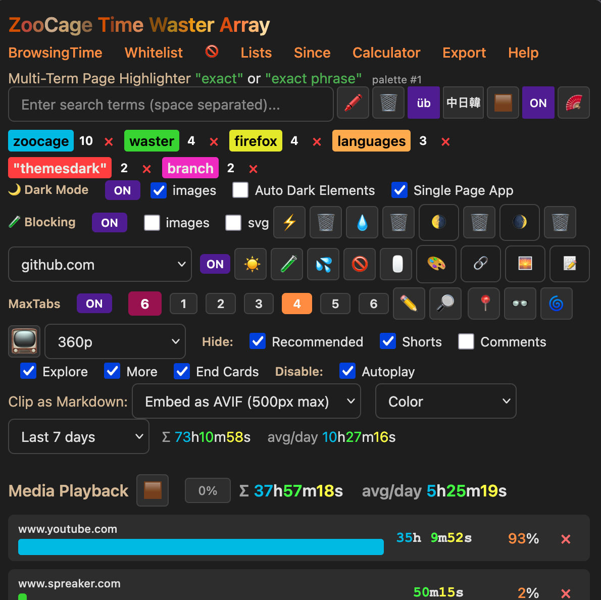

Track time spent browsing and watching media on YouTube, etc., Calculator, Unit Conversion, Dark Mode, Multi-Term Page Highlighter, Blur Images/Videos, Block Sites, Allow Right-click,Join Images, Masonry Gallery, Code Snippets, Clip to Markdown 

uses avif image which take 4x as long to encode but usually 2x to 3x smaller in file size than jpg, png, etc.  So great for saving snippets of text with images on the web.

https://addons.mozilla.org/en-US/firefox/addon/zoocage-time-waster-array/

Here is Chrome version (not gonna pubish on google extension store or whatever it's called)
Main difference is doesn't have Dark Mode.
I use it for ZigZag https://zigzagbrowser.com even though it's WebKit and works only on Mac.
Right click and save as to download and unzip it and choose Install from folder.
 2MB
